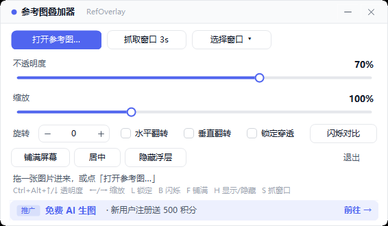

# RefOverlay 参考图叠加器

> 一个 **38 KB 的单文件小工具**：把任意一张图变成可以缩放、旋转、调透明度、还能**鼠标穿透**的半透明浮层，盖在 SketchUp / Rhino / Photoshop / D5 / Enscape 等任意窗口之上，用来比对透视、对相机角度。
>
> 由 [不囿成建 BYCJ Design](https://ai.bycjdesign.com/) 免费发布，MIT 协议。



---

## 它解决什么问题

做实景合成、鸟瞰对位、模型套照片的时候，最常见的土办法是「把两个软件叠在一起，人工比角度」。问题是：

- 把 SketchUp / Photoshop 的窗口改成半透明，这些 GPU 直绘的窗口在不少显卡驱动下会黑屏、闪烁、坐标错位；
- 就算透明了，鼠标也只有一份 —— 你想一边看照片一边转 SketchUp 的相机，做不到。

RefOverlay 换了个思路：**不动目标窗口，只在自己身上开一个浮层**。浮层是一个独立的、带逐像素透明通道的顶层窗口，由 Windows 的合成器（DWM）直接混在目标窗口的画面上，所以目标软件完全不知道它存在，渲染管线一点没被碰。浮层还能「锁定」成点击穿透，鼠标直接穿过去操作下面的 SketchUp —— **边转相机边看对齐**。

```text
┌──────────── DWM 合成 ────────────┐
│  SketchUp 窗口（正常、不受影响）  │
│  ┌────────────────────────────┐  │
│  │ RefOverlay 浮层  α=45%     │  │  ← 逐像素 alpha，PNG 透明背景也能用
│  │ （锁定后鼠标穿透）          │  │
│  └────────────────────────────┘  │
└──────────────────────────────────┘
```

## 功能

- **图片浮层**：PNG / JPG / BMP / TIFF，任意 DPI 都是 1:1 原始像素载入；带 alpha 的 PNG 只在有像素的地方出现。
- **不透明度 5–100%**、**缩放 5–300%**、**旋转 ±180°**、**水平/垂直翻转**。
- **点击穿透**：锁定后鼠标穿过浮层，直接操作下面的软件；解锁后才能拖动浮层。
- **闪烁对比**：在当前透明度和 0% 之间来回切，靠视觉暂留找角度差，比慢慢拖滑块准得多。
- **抓任意窗口**：`PrintWindow` + `PW_RENDERFULLCONTENT`，能抓 OpenGL / D3D 内容，不怕被遮挡；也可以 3 秒倒计时抓鼠标下那个窗口。
- **全局热键**：任何软件在前台都生效。
- **完全离线**：不联网、不上传任何图片、不写注册表。

## 用法

1. 双击 `启动 RefOverlay.bat`，或直接运行 `RefOverlay.exe`（Windows 10/11，系统自带 .NET Framework 4.x 即可，不需要安装任何运行时）。
2. 点「打开参考图…」或**把图片拖进面板**。
3. 需要边看边操作时，勾上「锁定穿透」或按 `Ctrl+Alt+L`。

| 热键 | 作用 |
|---|---|
| `Ctrl+Alt+↑ / ↓` | 不透明度 ±5% |
| `Ctrl+Alt+← / →` | 缩放 ∓5% |
| `Ctrl+Alt+L` | 锁定 / 解锁（点击穿透） |
| `Ctrl+Alt+B` | 闪烁对比 |
| `Ctrl+Alt+F` | 铺满屏幕 |
| `Ctrl+Alt+H` | 显示 / 隐藏浮层 |
| `Ctrl+Alt+S` | 3 秒后抓取鼠标下的窗口 |

解锁状态下：左键拖动移动浮层，滚轮缩放。

## 关于底部的推广入口

面板底部有一条「免费 AI 生图」入口，点击会打开 **[ai.bycjdesign.com](https://ai.bycjdesign.com/)** —— 这是本工具作者自己的 AI 创作站点，**通过该入口新注册的用户赠送 500 积分**。

这是本工具**唯一的商业入口**，它不影响任何功能，也不会把使用数据回传。如果你只想要纯粹的工具，可以忽略它，或者在源码里改掉 `PanelForm.AdUrl` 这一行常量自行编译。

## 编译

源码是单文件 C# 5 / .NET Framework 4.x，只用系统自带的编译器，不需要 Visual Studio：

```powershell
powershell -ExecutionPolicy Bypass -File .\build.ps1
```

## 已知限制

- 浮层是「盖在上面的图」，**不跟随**目标窗口滚动/缩放；移动目标窗口后浮层位置要自己再对一下。
- 抓窗口用的是 `PrintWindow`，个别开了硬件覆盖（overlay）或带 DRM 保护的窗口会抓到全黑，程序会提示失败；换「3 秒抓光标下窗口」通常能成。
- 只支持 Windows（用到了 `UpdateLayeredWindow`）。

## License

[MIT](LICENSE)
